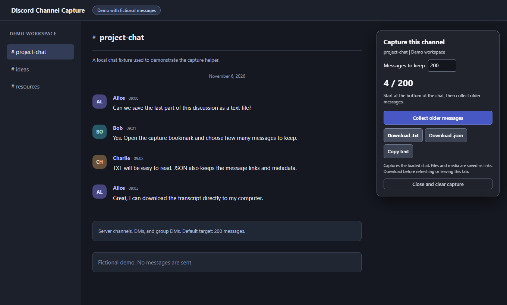

# Discord Channel Capture

Save a small slice of a Discord conversation as a text or JSON file. This browser bookmarklet works with server channels, DMs, and group DMs by reading messages loaded in the Discord web app.

It is useful when you want a readable transcript of a recent discussion without setting up a bot or providing an account token.



*The screenshot uses a local demo with fictional messages, not a real Discord conversation.*

## Use it

No installation or Node.js is needed to use the bookmarklet.

1. Download this repository as a ZIP using **Code > Download ZIP**, then extract it.
2. Open `setup.html` in your desktop browser.
3. Show your bookmarks bar with **Ctrl + Shift + B**, then drag **Capture Discord chat** onto it.
4. Open [Discord in your browser](https://discord.com/channels/@me) and choose a server channel, DM, or group DM. Scroll to the bottom to start from the newest messages.
5. Click the bookmark and choose **Collect older messages**. The default target is 200; you can choose 1 to 500.
6. Choose **Download .txt**, **Download .json**, or **Copy text**. You can stop and export before reaching the target.

If automatic scrolling stops early, scroll upward inside the chat yourself. The counter updates as messages load. Keep the Discord tab open while collecting.

When updating the script, replace your existing bookmark using the new `setup.html`. Download any current capture and close its panel before running the replacement.

## What it captures

- Message text, author names, timestamps, emoji labels, and readable embed text.
- Attachment and media links, without downloading the files.
- Message links and chat metadata in chronological order.
- A fixed window ending at the newest message loaded when capture starts. New messages arriving later do not move that boundary.

Server exports start with `discord-channel-`; DM and group DM exports start with `discord-dm-`. The JSON output includes the requested count, captured count, and whether the target was reached.

## Privacy and limits

The helper reads the current chat's page content. It does not access account tokens, cookies, or passwords, post messages, or upload transcripts. It does not make its own network requests; scrolling can cause Discord itself to load older messages normally.

Captured messages stay in tab memory until you copy or download them. Refreshing or closing the tab clears the capture. Switching chats stops collection and leaves the original chat's export available.

This is a capture of loaded messages, not a complete account or channel backup. Deleted, inaccessible, or unloaded messages are unavailable. Attachment links may expire, and text inside images is not transcribed. Some message types may have no readable text. A grouped message can have an unknown author until its earlier author header loads.

Automated checks use fictional chats in Edge or Chromium. Live compatibility depends on Discord's page structure, which can change. Other desktop browsers have not been verified. This is an independent project and is not affiliated with Discord.

Real transcript filenames, `captures/`, and `exports/` are ignored by Git. Keep personal captures outside the repository.

## Development

The capture script is plain JavaScript. Node.js builds the setup page, and Playwright Core runs browser checks against local fixtures. There are no runtime package dependencies.

With Node.js 22 or newer:

```powershell
npm install
npx playwright-core install chromium
npm run check
```

To test with an already installed Microsoft Edge instead of downloading Chromium, use PowerShell:

```powershell
$env:CAPTURE_BROWSER_CHANNEL = 'msedge'
npm run check
Remove-Item Env:CAPTURE_BROWSER_CHANNEL
```

Useful commands:

| Command | Purpose |
| --- | --- |
| `npm run build` | Rebuild the self-contained `setup.html` from `capture.js`. |
| `npm test` | Test exports, authors, message limits, chat switching, DMs, and scrolling with fake messages. |
| `npm run check` | Check JavaScript syntax, rebuild setup, and run browser tests. |
| `npm run screenshot` | Run checks and regenerate the screenshot from the fictional demo. |

The tests do not sign in to Discord or read real conversations. The browser intercepts the fixture navigation and serves local HTML.

## Files

| File | Purpose |
| --- | --- |
| `capture.js` | The code embedded in the capture bookmark. |
| `build-setup.cjs` | Builds the setup guide and bookmark URL. |
| `setup.html` | Ready-to-use setup guide, included for users without Node.js. |
| `verify.cjs` | Browser checks using fictional messages. |
| `docs/demo.html` | Fictional chat used for the screenshot. |

## Publish your copy to GitHub

With Git, GitHub CLI, and Node.js installed, open PowerShell in this folder and run:

```powershell
.\publish-github.ps1
```

The script opens GitHub sign-in if needed, creates an initial commit using a GitHub noreply email address, and creates a **public** repository named `discord-channel-capture` in your signed-in account. It adds the project description and topics. It stages only the listed project files and never force-pushes.

Use `-Visibility private` for a private repository or `-RepositoryName another-name` to choose a different name. An existing origin must match the selected account and repository. Repository creation stops if that name is already taken; the script does not overwrite an unrelated repository. When retrying a push to a previously created repository, its visibility is preserved.

If Git reports **dubious ownership** after a sandbox or another Windows account created the repository, run these commands from this project folder in your own PowerShell, then rerun the publish script:

```powershell
$captureProjectPath = (Resolve-Path .).Path.Replace('\', '/')
git config --global --add safe.directory "$captureProjectPath"
.\publish-github.ps1
```

This adds an ownership exception for this project only. The publish script reports the command when needed and does not change your trusted directories automatically.

## License

MIT. See [LICENSE](LICENSE).
